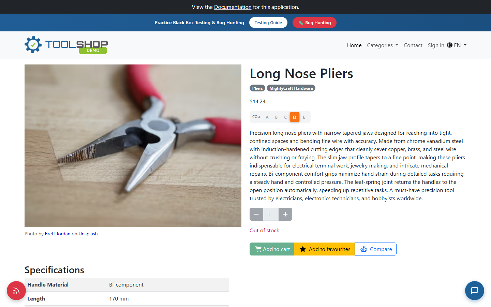

# FIND-02 · Out-of-stock SKU blocked in UI, accepted by Cart API

**Environment:** `https://practicesoftwaretesting.com` and `https://api.practicesoftwaretesting.com`, observed 2026-11-20.  
**Evidence:** [Out-of-stock UI screenshot](../evidence/find-02-out-of-stock-ui.png) · [Captured Cart API response (JSON)](../evidence/find-02-cart-api-response.json) · [Automated check (`TC-API-004`)](../../tests/pw/api/margin-tampering.spec.ts#L91-L109)

## Expected vs. observed behavior

| Layer | Expected | Observed on live Toolshop |
| --- | --- | --- |
| **Storefront UI** | Out-of-stock product (`in_stock: false`) cannot be added to the cart. | Displays `Out of stock` (`[data-test="out-of-stock"]`) and disables the `Add to cart` button (`Long Nose Pliers`, `$14.24`). |
| **Cart API** | `POST /carts/{cartId}` rejects an `in_stock: false` product with a stock-specific client error. | Returns `200 OK` (`{"result": "item added or updated"}`), and `GET /carts/{cartId}` contains the item with `in_stock: false`. |

## Root cause in upstream code

In upstream Sprint 5:
- [`CartController.php`](https://github.com/testsmith-io/practice-software-testing/blob/main/sprint5/API/app/Http/Controllers/CartController.php) validates only `'product_id' => 'required|string|exists:products,id'` and `'quantity' => 'required|integer|min:1|max:99'`.
- [`CartService.php`](https://github.com/testsmith-io/practice-software-testing/blob/main/sprint5/API/app/Services/CartService.php) enforces the max-1 limit for `Thor Hammer`, but never checks `$product->in_stock`.

## Upstream context

Toolshop is a training app. Checking `testsmith-io/practice-software-testing` issues shows `#793` added quantity bounds validation, while no open or closed issue tracks `in_stock` enforcement in the Cart API. In production e-commerce, UI-only stock gating allows overselling through direct API requests or stale tabs.

## Automated control

`TC-API-004` confirms that the known `200` response actually added the selected out-of-stock item to a fresh cart. A `409` or `422` with `OUT_OF_STOCK` or an explicit out-of-stock validation message on `product_id` signals a possible fix and triggers promotion review. Unrelated validation, a catalog re-seed, server or transport failure, and ambiguous cart evidence fail the watch as inconclusive.
