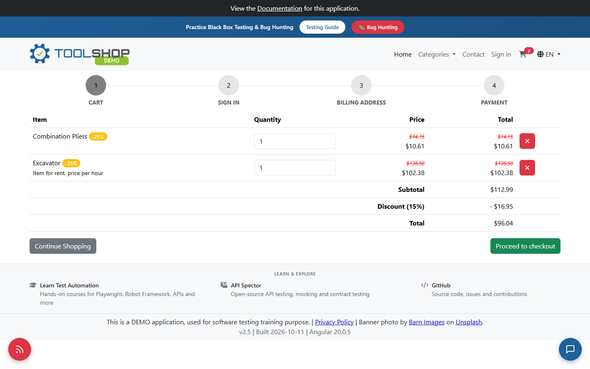

# FIND-03 · Geolocation discount applied to non-offer SKUs and stacked with 15% combination discount

**Environment:** `https://practicesoftwaretesting.com` and `https://api.practicesoftwaretesting.com`, observed 2026-11-20.  
**Evidence:** [Checkout UI screenshot](../evidence/find-03-discount-stacking-ui.png) · [Captured Cart API & UI summary (JSON)](../evidence/find-03-discount-stacking.json) · [Automated check (`TC-API-005`)](../../tests/pw/api/margin-tampering.spec.ts#L111-L150)  
**Severity:** High ([scale](../01-test-strategy.md#6-severity-scale))  
**Business impact:** Items excluded from location offers still get up to 25% off, and the 15% combination discount stacks on top: a 36.25% effective reduction on every mixed retail and rental basket in a discount region.

## Reproduction

1. Create a cart with London coordinates: `POST /carts` with `{"lat": 51.5, "lng": -0.12}` (25% geolocation tier).
2. Add 1 unit of a retail product with `is_location_offer: false` (`Combination Pliers`, `$14.15`).
3. Add 1 hour of a rental product (`Excavator`, `$136.50`, `is_rental: true`).
4. Read `GET /carts/{cartId}` and open `/checkout` with that cart.

```sh
API=http://localhost:8091   # isolated stack
CART=$(curl -s -X POST "$API/carts" -H 'Content-Type: application/json' -d '{"lat":51.5,"lng":-0.12}' | jq -r .id)
PLIERS=$(curl -s "$API/products?page=1" | jq -r '.data[] | select(.name == "Combination Pliers") | .id')
RENTAL=$(curl -s "$API/products?is_rental=true" | jq -r '.data[0].id')
for ID in "$PLIERS" "$RENTAL"; do
  curl -s -X POST "$API/carts/$CART" -H 'Content-Type: application/json' -d "{\"product_id\":\"$ID\",\"quantity\":1}"
done
curl -s "$API/carts/$CART" | jq '{additional_discount_percentage, items: [.cart_items[] | {name: .product.name, discount_percentage, discounted_price}]}'
# Observed: additional_discount_percentage 15; Combination Pliers 25 → 10.61; Excavator 25 → 102.38
```

## Observed behavior

- `Combination Pliers` has `is_location_offer: false`, yet the Cart API assigns `discount_percentage: 25` (`$14.15` → `$10.61`).
- Mixing retail + rental also sets `additional_discount_percentage: 15` on the cart.
- Both discounts compound: `$10.61 + $102.38 = $112.99`, minus `15%` (`-$16.95`) = **`$96.04`** — an effective **36.25%** reduction on an item flagged as ineligible for location offers.



## Root cause in upstream code

In [`CartService.php`](https://github.com/testsmith-io/practice-software-testing/blob/main/sprint5/API/app/Services/CartService.php#L63):

```php
if ($cart->lat && $cart->lng && isset($existingItem->product->is_location_offer)) {
    $discount = $this->calculateDiscountPercentage($cart->lat, $cart->lng);
```

In PHP, `isset(false)` returns `true`. Checking `isset()` instead of truthiness (`!empty(...)` or `(bool)`) causes every product with a non-null boolean `is_location_offer` column — including `false` — to receive the geolocation discount. `updateCartDiscounts()` then applies `additional_discount_percentage = 15` independently, compounding both discounts.

## Upstream context

Checked `testsmith-io/practice-software-testing` issues: `#124` covered showing discounts on invoices/PDFs; no open or closed issue tracks the `isset(false)` bug or discount stacking cap.

## Automated control

`TC-API-005` (`@known-spec-discrepancy`) creates an ephemeral London cart with a live `is_location_offer: false` retail SKU plus a rental item and tracks the bug via `expectKnownDiscrepancy('FIND-03', ...)`.
