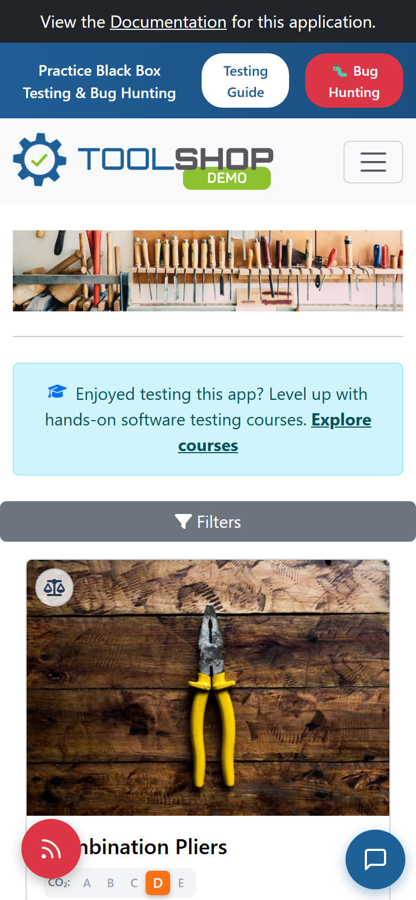
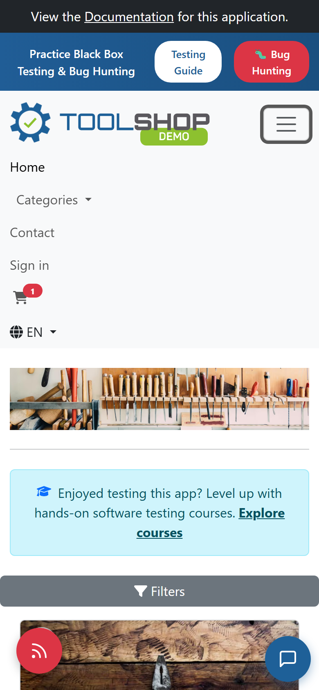

# FIND-04 / FIND-05 / FIND-06 · Mobile viewport (`390×844`) checkout friction & duplicate test ID

**Environment:** `https://practicesoftwaretesting.com`, headless Chromium mobile viewport (`390×844`, `isMobile: true`, `hasTouch: true`), observed 2026-11-20.  
**Evidence:** [Collapsed mobile header screenshot](../evidence/find-04-mobile-header-collapsed.png) · [Expanded mobile header screenshot](../evidence/find-04-mobile-header-expanded.png) · [DOM & geometry observations (JSON)](../evidence/find-04-06-mobile-observations.json) · [Mobile test (`TC-MOB-001`)](../../tests/pw/mobile/money-path.mobile.spec.ts)

## Observations

| ID | Area | Observed at `390×844` | Automation guardrail |
| --- | --- | --- | --- |
| **FIND-04** | Header cart visibility | After adding `Combination Pliers` to cart, `nav-cart` and its badge (`1`) are hidden inside the collapsed Bootstrap hamburger menu (`navCartVisibleWhenCollapsed: false`). A shopper gets no persistent cart badge in the top bar. | `HeaderNav.ensureNavExpanded()` ([`src/components/HeaderNav.ts`](../../src/components/HeaderNav.ts)) |
| **FIND-05** | Mobile CTA & floating widget | On Product Detail, `Add to cart` renders below the fold at `y = 1120px` (viewport height `844px`). On Catalog, the bottom-left floating feed widget overlaps the first product title (`Combination Pliers`). | `scrollIntoViewIfNeeded()` in `ProductDetailsPage.addToCart()`, overflow check in `TC-MOB-001` |
| **FIND-06** | Duplicate `data-test="filters"` | Two DOM nodes carry `data-test="filters"`: the mobile `<button>` toggle and the `
` panel. Unscoped `getByTestId('filters')` fails Playwright strict mode. | Explicitly scoped `mobileToggleButton` and `container` in [`src/components/CatalogFilters.ts`](../../src/components/CatalogFilters.ts) |

### Visual evidence (`390×844`)

- **Collapsed header (1 item in cart, no cart badge visible, bottom-left widget overlapping card title):**  
  
- **Expanded header (cart badge `1` only appears after tapping hamburger):**  
  

### WebKit cart overflow (TC-MOB-001)

The November 20, 2026 showcase run measured a 422 px document in a 390 px iPhone 14 WebKit viewport on both attempts at `/checkout`, step 1 (Cart), with one Combination Pliers item. In the failure screenshot, the rightmost remove control is partly outside the viewport. The overflow assertion remains in the gate. Chromium passed the same path in that run.

On November 21, a local run against pinned Sprint 5 revision `ae7caecb811dd8952c09d997e69be7cb946ecd44` reproduced 422 px versus 390 px on both Linux WebKit attempts (Debian Bookworm, Playwright 1.65.1). The same test passed in WebKit and Chromium on Windows.

[Failure screenshot](../evidence/mobile-cart-overflow-webkit-ci.png) · [QA run and `report-mobile` trace](https://github.com/vmurashev365/toolshop-showcase/actions/runs/44769291883#artifacts)
