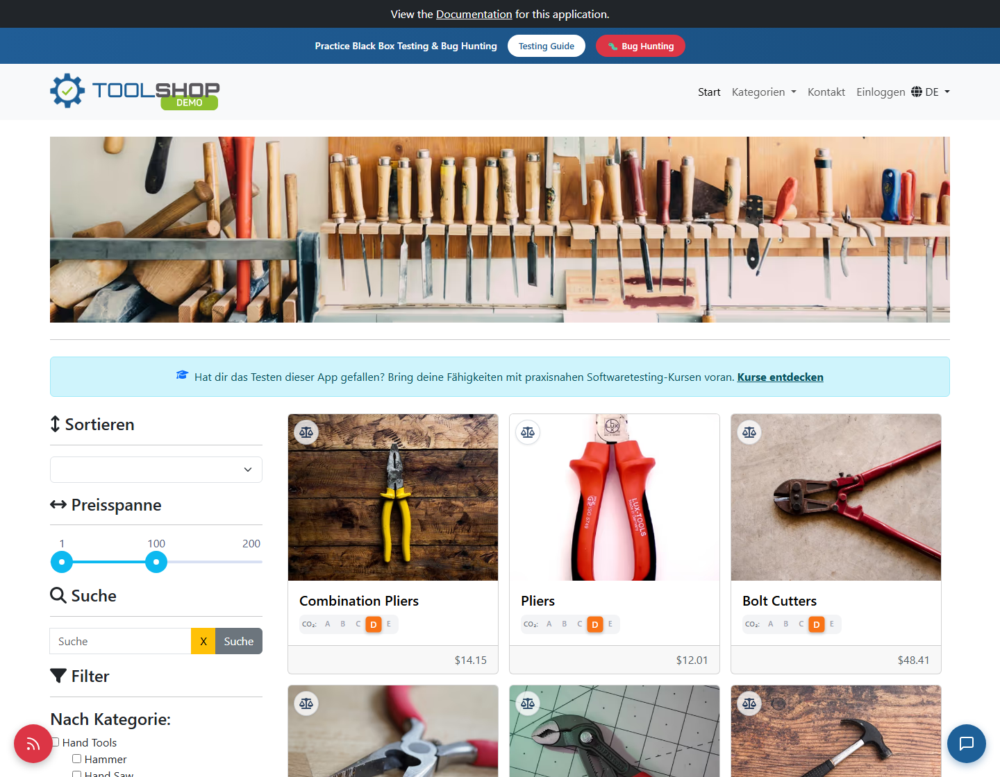

# FIND-07 / FIND-08 · WCAG 2.1 AA axe violations & `DE` localization currency

**Environment:** `https://practicesoftwaretesting.com`, headless Chromium (`1440×900`), `@axe-core/playwright` (`wcag2a`, `wcag2aa`, `wcag21a`, `wcag21aa`), observed 2026-11-20.  
**Evidence:** [Axe WCAG 2.1 AA scan output (JSON)](../evidence/find-08-axe-wcag-violations.json) · [German locale catalog screenshot](../evidence/find-07-de-locale-usd.png) · [A11y ratchet (`TC-A11Y-001`)](../../tests/pw/ux/a11y-checkout.spec.ts) · [DE i18n check (`TC-I18N-001`)](../../tests/pw/ux/localization-de.spec.ts)

## FIND-08 · Serious WCAG 2.1 AA violations on core funnel screens

**Severity:** Medium ([scale](../01-test-strategy.md#6-severity-scale))  
**Business impact:** screen-reader and voice-control users meet mislabeled controls on the pages that lead to a purchase. This is also a compliance risk under accessibility regulations such as the European Accessibility Act.  
**Reproduce:** run `npx playwright test --project=ux-guards -g TC-A11Y-001`, or scan Catalog, Product Detail, and Checkout Cart with an axe browser extension using the WCAG 2.1 A and AA rule sets.

Scanning Catalog, Product Detail, and Checkout Cart with `@axe-core/playwright` surfaces two `serious` rule violations (zero `critical`):

| Rule ID | Impact | Screens | Failing elements |
| --- | --- | --- | --- |
| `label-content-name-mismatch` | `serious` | Catalog, Product Detail, Checkout Cart | `#language` (`aria-label="Select language"` does not contain visible label `EN`) and `a[data-test="nav-cart"]` (`aria-label="cart"` does not contain visible badge count) |
| `list` | `serious` | Catalog | `.checkbox > ul` filter lists contain direct `<fieldset>` children instead of `<li>` |

### Ratchet control (`TC-A11Y-001`)

`TC-A11Y-001` baselines only these two pre-existing `serious` violations so the gate:
1. **Blocks every new** `critical` or `serious` violation on Catalog, Product Detail, and Checkout Cart.
2. **Fails if a baselined violation is fixed**, prompting removal from `KNOWN_SERIOUS_VIOLATIONS` so the baseline tightens over time and cannot hide a regression later.

## FIND-07 · `DE` locale translates UI chrome but keeps USD formatting

**Severity:** Low ([scale](../01-test-strategy.md#6-severity-scale))  
**Business impact:** German-speaking shoppers see prices in USD. This matters only if a German market requires EUR, which is not yet a stated requirement.  
**Reproduce:** open the storefront, switch the language selector in the top bar to `DE`, and compare the translated navigation with the `$14.15` prices.

Switching language to `DE` translates navigation and filter controls (`Start`, `Kategorien`, `Kontakt`, `Einloggen`, `Sortieren`, `Preisspanne`, `Suche`), while product prices remain USD (`$14.15`). `TC-I18N-001` verifies German UI chrome, zero horizontal overflow, loaded images, and consistent `$xx.xx` formatting until currency localization (`EUR` / `14,15 €`) is defined as a requirement.

